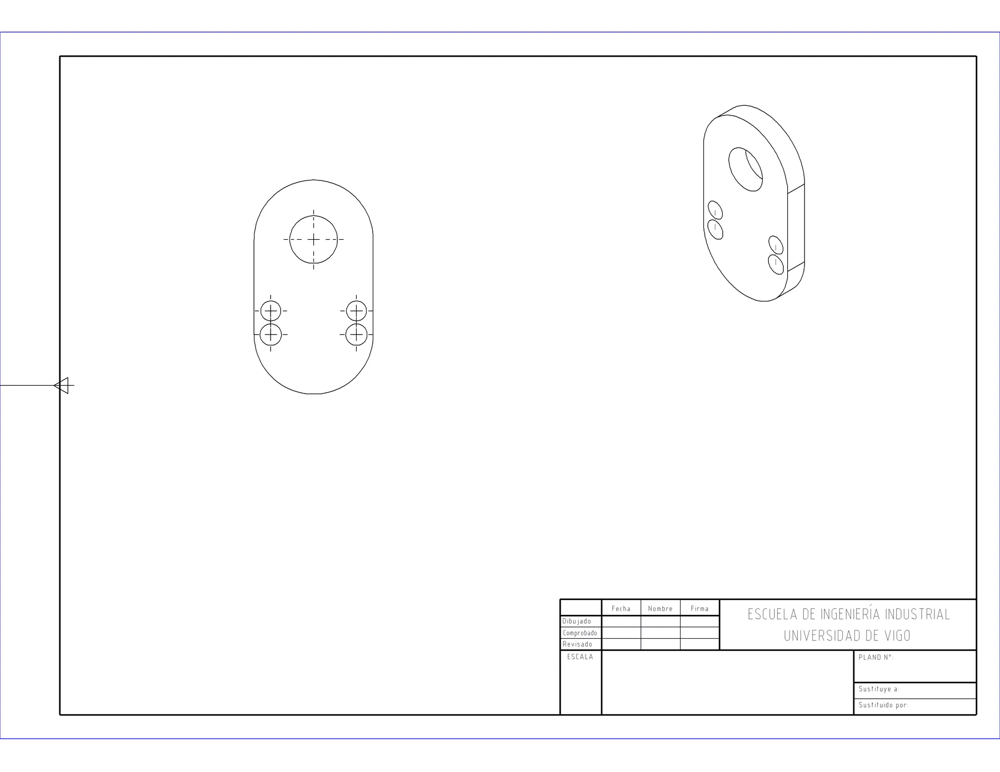
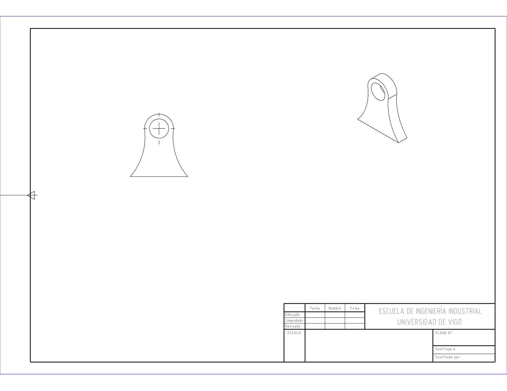

# Asistente de planos 2D para SolidWorks

*[English version below](#english)*

Motor en Python que, a partir de una pieza de SolidWorks, genera su plano 2D de fabricación por la API COM del programa. Es la base de un asistente de IA que se manejará en lenguaje natural.

> **Estado: en desarrollo.** Fase 1 en curso. El motor ya genera planos con vistas en las 8 piezas del banco de pruebas. Faltan la acotación automática, el relleno del cajetín, la lista de materiales y la exportación a DXF.

| | |
|---|---|
|  |  |
| Enlace de bieletas | Soporte de caliper |

*Planos generados por el motor sin intervención manual. Todavía sin cotas ni cajetín relleno.*

## La idea

Pedirle a un modelo de lenguaje que dibuje moviendo la geometría da resultados que no son fiables ni repetibles. Por eso el proyecto separa las dos cosas:

1. La IA solo traduce lo que pide el usuario a un JSON con un esquema cerrado.
2. Un motor determinista en Python ejecuta ese JSON contra la API de SolidWorks.
3. Las señales de verificación (reconstrucción, errores legibles, comprobación de norma) vuelven a la IA para que se corrija.

La IA nunca hace llamadas directas a la geometría.

## Qué hace hoy

- Crea el plano en una maqueta A3 fija, con el alzado a escala 1:1 preferente y la isométrica con su propia escala.
- Pone marcas de centro automáticas y no invade el cajetín.
- Vista de sección opcional (`--con-seccion`).
- Exporta a PDF o PNG.
- La normativa vive en ficheros de datos, no en el código. La primera tabla es la de agujeros de paso de ISO 273 ([datos/iso273-agujeros-paso.yaml](datos/iso273-agujeros-paso.yaml)).

## Requisitos

- Windows con **SOLIDWORKS 2023** abierto. Es la única versión probada; las llamadas a la API usadas están en [COMPATIBILITY.md](COMPATIBILITY.md).
- Python 3 con `pywin32` y `PyYAML` (`pip install -r requirements.txt`).
- Formatos de hoja `.slddrt`. Los del proyecto son de la escuela de ingeniería y no se incluyen; indica su carpeta con la variable de entorno `PLANOS_PLANTILLAS`.

## Uso

```powershell
$env:PLANOS_PLANTILLAS = "C:\ruta\a\las\plantillas"
python src\motor_plano.py "C:\ruta\pieza.SLDPRT"          # una pieza
python src\motor_plano.py --con-seccion "C:\ruta\carpeta"  # todas las piezas de una carpeta
python src\exportar_pdf.py --formato pdf "C:\ruta\plano.SLDDRW"
python src\validar_normas.py                               # comprueba la tabla ISO 273
```

## Estructura

| Ruta | Qué es |
|---|---|
| [src/motor_plano.py](src/motor_plano.py) | El motor: crea el plano, coloca las vistas y las marcas de centro |
| [src/exportar_pdf.py](src/exportar_pdf.py) | Exporta planos a PDF o PNG |
| [src/clasificar_planas.py](src/clasificar_planas.py) | Mide las piezas por su caja envolvente para elegir el banco de pruebas |
| [src/normas.py](src/normas.py) · [src/validar_normas.py](src/validar_normas.py) | Lectura y comprobación de la base normativa |
| [datos/](datos/) | Normativa codificada como datos |
| [SPEC-familia.md](SPEC-familia.md) | La familia de piezas (placas planas taladradas) y los criterios de delineación |
| [ESTUDIO-Y-PLAN.md](ESTUDIO-Y-PLAN.md) | Estudio inicial y plan por fases |

Las piezas del banco de pruebas no están en el repo por peso: son binarios CAD de trabajos universitarios propios.

## Autoría

Proyecto propio de aprendizaje y portfolio, iniciado en julio de 2026. El código lo he desarrollado dirigiendo a agentes de IA (Claude Code y Codex): yo defino qué hay que hacer, decido el diseño y verifico el resultado contra el banco de pruebas. El caso completo está en mi [portfolio](https://estebanpinillaalva-spec.github.io/casos/planos-2d.html).

---

## English

A Python engine that takes a SolidWorks part and generates its 2D manufacturing drawing through the SolidWorks COM API. It is the foundation for an AI assistant that will be driven in natural language.

> **Status: in progress.** Phase 1 under way. The engine already generates drawings with views for all 8 test-bench parts. Automatic dimensioning, title-block filling, bill of materials and DXF export are still to come.

**The idea.** Asking a language model to draw by moving the geometry gives results that are neither reliable nor repeatable, so the project keeps the two apart. The AI only translates the user's request into JSON with a closed schema. A deterministic Python engine executes that JSON against the SolidWorks API. Verification signals (rebuild, readable errors, standards check) go back to the AI so it can correct itself. The AI never makes direct calls to the geometry.

**What it does today.** It creates the drawing on a fixed A3 layout, with the front view at a preferred 1:1 scale and the isometric view at its own scale. It adds centre marks automatically without overlapping the title block, offers an optional section view (`--con-seccion`) and exports to PDF or PNG. Standards live in data files, not in the code; the first table covers ISO 273 clearance holes.

**Requirements.** Windows with SOLIDWORKS 2023 running (the only version tested; the API calls used are listed in [COMPATIBILITY.md](COMPATIBILITY.md)), Python 3 with `pywin32` and `PyYAML`, and `.slddrt` sheet formats. The project's formats belong to the engineering school and are not included; point the `PLANOS_PLANTILLAS` environment variable to their folder. Usage is shown in the Spanish section above. Code, comments and project documents are in Spanish.

**Authorship.** A personal learning and portfolio project, started in July 2026. I developed the code by directing AI agents (Claude Code and Codex): I define what needs to be done, make the design decisions and verify the result against the test bench. The full case study is on my [portfolio](https://estebanpinillaalva-spec.github.io/en/cases/planos-2d.html).
